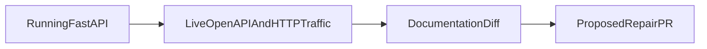

1. Diff documentation against a live OpenAPI spec and real traffic, open a PR to fix drift.

2. Result:
   Seeded documentation drifts detected: 10  
   False positives on clean contracts: 0  
   Actual local HTTP responses observed: 10  

   Measured with `make bench`: [raw results](evidence/bench.json), [command output](evidence/checks.log), [environment](evidence/environment.json).

3. Architecture:


4. Run it:
```sh
make setup
make lint test bench
make demo
```

5. Decisions and limits: Original local FastAPI application and actual HTTP client requests through TestClient, not traffic from a third-party service. Ten independently seeded documentation discrepancies cover paths, methods, operation IDs, parameter schema, response fields, status, requiredness and example types. Evidence retains served OpenAPI, observed traffic, drifted docs and a clean proposed repair. This checks the supported JSON/OpenAPI subset, not arbitrary prose or all OpenAPI features. The repair PR and GitHub Action are demonstrated in this own repository; no external maintainers are contacted. Verified repair PR: https://github.com/rjrddy/x3-api-docs-drift-detector/pull/1. The stale branch failed CI run 39434554512, and the repaired PR passed run 39434569367. scripts/open_repair_pr.py ships the explicit-repository PR publishing command; it requires authenticated gh and never contacts a third-party maintainer by default.

6. Next: Parse markdown examples, ingest proxy traffic with redaction, and handle composed/nullable schemas.
